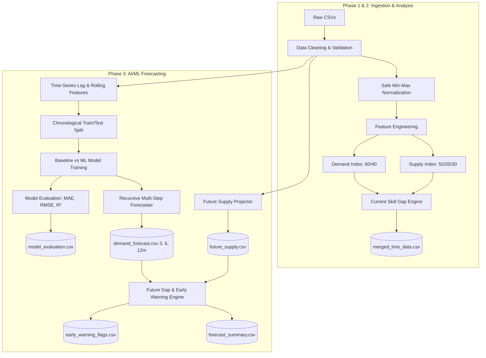

# Skill Intelligence Platform — Methodology & Intelligence Framework (SIH_26246)

> **IMPORTANT DISCLAIMER — PROTOTYPE METHODOLOGY & SAMPLE DATA:**  
> The forecasting system, statistical models, index weights, and classification thresholds documented here are **prototype architectures developed for the Smart India Hackathon (SIH) solution**. Model performance depends directly on the quantity, quality, granularity, and historical depth of available administrative records. **Forecast outputs and indices are not official MSDE forecasts or government statistics**, but rather an early-warning functional demonstration for evidence-based vocational planning.

---

## 1. What is Labour Demand?
In this platform, **Labour Demand** represents the volume and growth velocity of hiring requirements posted by employers across industries in a specific district, sector, and trade qualification.

- **Primary Volume Metric**: Active **Job Postings** (`job_postings`) observed during a reporting period.
- **Velocity Metric**: **Hiring Growth** (`hiring_growth`), capturing month-over-month expansion or contraction trends in employer hiring.

---

## 2. What is Skilled Supply?
Rather than assuming approved training seats alone equal labour supply, our intelligence engine distinguishes between institutional capacity and real workforce output:

- **Installed Capacity**: Sanctioned **Training Seats** (`training_seats`) in ITIs and vocational centers.
- **Candidate Cohort**: Total registered and enrolled trainees (`candidates_enrolled`).
- **Operational Skilled Supply**: **Candidates Certified** (`candidates_certified`), representing assessed candidates who successfully completed qualifications and are ready for workforce employment.
- **Placement Outcomes**: Candidates placed (`candidates_placed`) and the **Placement Rate** (`placement_rate`).

---

## 3. Data Normalization
Because different trades and districts vary drastically in scale (e.g., thousands of software engineers in Bengaluru vs. dozens of welders in smaller industrial districts), numerical features are rescaled using **Min-Max Normalization**:

$$\text{Normalized Value} = \frac{\text{Value} - \text{Minimum}}{\text{Maximum} - \text{Minimum}}$$

### Edge Case Protection:
When $\text{Maximum} == \text{Minimum}$, division by zero is safely prevented by returning a default value of `0.0`.

---

## 4. Demand Index (0 to 100)
The **Demand Index** summarizes the employer market appetite for a trade into a standardized score between $0$ and $100$:

$$\text{Raw Demand Score} = (0.60 \times \text{NormPostings}) + (0.40 \times \text{NormHiringGrowth})$$
$$\text{Demand Index} = \text{clip}(\text{Raw Demand Score} \times 100, 0, 100)$$

- **Job Postings Volume Weight**: **60%** ($0.60$)
- **Hiring Growth Rate Weight**: **40%** ($0.40$)

---

## 5. Supply Index (0 to 100)
The **Supply Index** evaluates institutional output, capacity, and placement performance into a standardized score between $0$ and $100$:

$$\text{Raw Supply Score} = (0.50 \times \text{NormCertified}) + (0.20 \times \text{NormCapacity}) + (0.30 \times \text{NormPlacement})$$
$$\text{Supply Index} = \text{clip}(\text{Raw Supply Score} \times 100, 0, 100)$$

- **Certified Candidates (Skilled Output)**: **50%** ($0.50$)
- **Training Capacity / Seats Utilization**: **20%** ($0.20$)
- **Placement Performance**: **30%** ($0.30$)

---

## 6. Current Skill Gap Calculation
$$\text{Gap} = \text{Demand} - \text{Supply}$$
$$\text{Gap Percentage} = \left(\frac{\text{Demand} - \text{Supply}}{\text{Demand}}\right) \times 100$$

*(Where $\text{Demand} = \text{job\_postings}$, and $\text{Supply} = \text{candidates\_certified}$)*

### Zero-Demand Edge Case:
- If $\text{Demand} == 0$ and $\text{Supply} > 0$: $\text{Gap Percentage} = -100.0\%$ (Complete Oversupply).
- If $\text{Demand} == 0$ and $\text{Supply} == 0$: $\text{Gap Percentage} = 0.0\%$ (Equilibrium).

---

## 7. AI/ML Forecasting Methodology (Phase 3)

The forecasting engine provides multi-horizon predictive intelligence to anticipate skill shortages before they materialize in the economy.

### 7.1 Historical Target & Time-Series Construction
- **Target Variable**: Monthly **Job Postings** (`job_postings`) grouped by `[state, district, sector, trade, nco_code]`.
- **Chronological Sorting**: Data is sorted strictly by date to ensure historical causality.

### 7.2 Feature Engineering (Without Look-Ahead Bias)
To capture autocorrelation, momentum, and seasonality without future data leakage:
1. **Lag Features**:
   - $\text{demand\_lag\_1} = \text{demand}_{t-1}$
   - $\text{demand\_lag\_2} = \text{demand}_{t-2}$
   - $\text{demand\_lag\_3} = \text{demand}_{t-3}$
2. **Rolling Moving Average**:
   - $\text{rolling\_mean\_3} = \frac{1}{3} \sum_{i=1}^{3} \text{demand}_{t-i}$
3. **Temporal Signals**:
   - Calendar Month ($1-12$), Quarter ($1-4$), Year, and observed Hiring Growth.

### 7.3 Chronological Train-Test Split
Rather than random shuffling (which leaks future patterns into past records), a strict **time-based split** is enforced:
- **Training Set**: Earlier ~80% historical months.
- **Holdout Test Set**: Latest ~20% historical months.

### 7.4 Model Training & Benchmark Comparison
- **Baseline Model**: Naive persistence forecast ($\hat{y}_t = y_{t-1}$).
- **Machine Learning Model**: `RandomForestRegressor` (ensemble of decision trees capturing non-linear interactions).
- **Evaluation Metrics**:
  - **MAE (Mean Absolute Error)**: Average absolute magnitude of forecast error (primary metric for non-technical policymakers).
  - **RMSE (Root Mean Squared Error)**: Standard deviation of residuals, penalizing large outlier errors.
  - **$R^2$ Score**: Proportion of variance explained by the model.

### 7.5 Multi-Horizon Recursive Forecasting (3, 6, 12 Months)
Multi-step forecasts are computed recursively:
$$\hat{y}_{t+1} = f(\text{history}_t)$$
$$\hat{y}_{t+2} = f([\hat{y}_{t+1}, \text{history}_t])$$
$$\dots \text{up to } \hat{y}_{t+12}$$
**Non-negative Constraint**: All predictions are bounded by $\max(0, \hat{y})$ to eliminate impossible negative demand counts.

### 7.6 Future Supply Estimation
Future operational skilled supply is projected using latest certified candidate volumes as baseline, applying modest projected institutional expansion (~2.5% p.a.):
$$\text{Estimated Supply}_{t+h} = \text{Current Certified} \times \left(1 + 0.025 \times \frac{h}{12}\right)$$

### 7.7 Future Skill Gap & Early Warning Severity Levels
$$\text{Future Gap} = \text{Predicted Demand} - \text{Estimated Supply}$$
$$\text{Future Gap Percentage} = \left(\frac{\text{Predicted Demand} - \text{Estimated Supply}}{\text{Predicted Demand}}\right) \times 100$$

| Early Warning Level | Condition | Recommended Policy Action |
| :--- | :--- | :--- |
| **HIGH** | $\text{Future Gap \%} > 35\%$ or $\text{Future Gap} \ge 250$ | **Critical Immediate Action**: Approve fast-track PMKVY centers, increase dual-system training batches, sanction emergency seat increases. |
| **MEDIUM** | $15\% < \text{Future Gap \%} \le 35\%$ | **Proactive Planning**: Coordinate with sector skill councils (SSCs) to mobilize student enrollments for upcoming academic cycle. |
| **LOW** | $0\% < \text{Future Gap \%} \le 15\%$ | **Monitoring**: Monitor local industry hiring notices and assess trainer availability. |
| **NONE** | $\text{Future Gap \%} \le 0\%$ (Balanced or Oversupply) | Maintain current training quotas; monitor candidate placement rates. |

---

## 8. Summary of Data Pipeline Architecture


---

## 9. How to Run the Complete Project

### Terminal 1 — Backend (FastAPI + Uvicorn)
```bash
uvicorn backend.app.main:app --reload
```
- **Backend API & Swagger Docs**: `http://127.0.0.1:8000/docs`
- **Health Check**: `http://127.0.0.1:8000/health`

### Terminal 2 — Frontend (React + Vite)
```bash
cd frontend
npm run dev
```
- **Frontend URL shown by Vite**: `http://localhost:5173` (or `http://127.0.0.1:5173`)
- Proxies `/api` and `/health` requests directly to `http://127.0.0.1:8000`.
